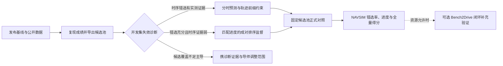

# 毕业论文完整执行方案

**暂定题目**　《基于世界模型的端到端驾驶轨迹选择方法研究》

**英文题名建议**　Trajectory Selection for End-to-End Autonomous Driving with a World Model

**版本**　v3.1，2026-11-18。主实验以 World4Scorer 为基线，在 NAVSIM v2.2 上完成诊断、方法改进和评测。Bench2Drive/CARLA 作为主实验完成后的可选补充。

论文研究端到端模型的**选轨错误**。在候选轨迹已经给定的条件下，有些动态交互场景同时存在一条有责碰撞轨迹和一条安全且能前进的轨迹。以 World4Scorer 为基线，先查清这类场景中有哪些错误可以靠重新选择避免，再改进候选轨迹的未来状态预测与评分，测量改进能减少多少危险选择、保留多少通行进度。研究对象落在生成候选之后、输出轨迹之前的环节。

## 1 研究问题与论文主张

1. **R1 可改善空间有多大。** 在固定候选池下，检测「没有安全且能前进的候选」与「有安全候选却选了碰撞轨迹」的频数。按日志和交互类型汇总，并人工复核代表样本。它回答研究选轨能覆盖哪些失败。
2. **R2 世界模型怎样改善选择。** 若预实验显示输入轨迹后段动作与近期风险判断的偏差反复关联，比较整条轨迹条件与时间前缀条件的分时预测。在同数据、监督、预算和候选下，报告危险错选与通行进度的配对差异。
3. **R3 收益在哪里成立。** 在完整 NAVSIM v2.2 单阶段评测中报告 EPDMS 和分项，并结合困难场景的配对差异和消融结果界定收益。

World4Scorer 发布权重的参考成绩为 NAVSIM v2.2 单阶段 navtest **91.4 EPDMS（关闭时序重排）/93.0（开启）**，两者使用同一模型权重。Bench2Drive-220 的 **73.27 Driving Score / 46.36% 成功率**对应作者发布的独立闭环模型。原论文附录 D.1 用固定的 DrivoR 候选池报告了 **99.33 PDMS 的事后最优均值**与原选择 **5.14 PDMS 的平均差距**。这是 NAVSIM v1 的实验，适合说明固定池诊断的动机。本文的 NAVSIM v2 诊断规模、错选占比和方法效果均待实测。[World4Scorer 发布结果](https://github.com/World4Scorer/World4Scorer#results) · [原论文附录 D.1](https://arxiv.org/html/2609.36438v1#A4.SS1)

### 1.1 预实验后的方法决策

- **时序误判可复现。** 将分时预测加上时间前缀限制作为主方案。候选未来 1、2、3 秒的预测状态分别读取截至该时刻的候选片段。以同样有分时预测、各时刻可读整条候选的对照检验输入限制的贡献。具体时刻在开发数据上做接口核查并冻结。
- **时序证据弱，错选数量充足。** 在同结构世界模型的状态评分上加入成对排序监督。用冻结规则匹配进度相近的安全/有责碰撞候选，在同候选、同训练预算下检验状态评分能否给安全候选更高排名。论文围绕观测到的错选写，不为时间前缀预留结论。
- **多数失败来自候选缺失，或错选样本过少。** 整理候选覆盖、失效分类和样例，与导师确认是否调整研究问题。冻结新方向后再启动正式训练。

建议在 **2026-12-13** 前完成上述决策。判断依据是按日志抽取的约 **300–500 个开发场景**、重复出现的错误模式、初步配对统计和至少三个可回放案例。样本量是开发目标，正式测试口径在独立验证数据上确定。

### 1.2 方法与实验组

| 组别 | 建议实现 | 论文中承担的证据 |
|---|---|---|
| B0 | 使用作者发布的原模型权重 | 复现基线，核对配置、候选输出与评分 |
| B1 | 原模型结构，同数据与训练预算继续训练 | 控制再训练本身的影响 |
| B2 | 分时预测，每个预测时刻读取整条候选 | 衡量分时预测本身的效果 |
| B3 | 分时预测，每个状态只读取截至对应时刻的候选片段 | 与 B2 比较，检验时间前缀限制 |
| B3-R | 预实验触发的备选，在 B1 世界模型状态评分中加入同进度安全/有责碰撞候选的成对排序监督 | 与 B1 比较，评估额外排序监督 |

从 E2 诊断起锁定候选池和候选 ID。学习方法共享冻结的视觉编码器和轨迹生成器，记录可训练参数、输入张量、监督来源和计算开销。未来图像特征只用于训练中真实执行的轨迹，其它候选的结果由统一评测器产生。B2 与 B3 使用相同的预测目标、监督强度、训练步数、模型选择规则与解码设置。SafeDrive 等已有工作提供分时风险评价先例，第 3 章需要说明本研究对照的是时间前缀限制对选择的作用。[World4Scorer 状态预测实现](https://github.com/World4Scorer/World4Scorer/blob/main/navsim/agents/drivoR/shared_future_predictor.py) · [SafeDrive 原论文](https://arxiv.org/abs/2602.18887)

## 2 论文目录与每章证据

### 第 1 章 绪论

- **1.1 研究背景与意义。** 解释候选生成之后的选轨为什么仍会出错。以「同一候选池有一个安全通行方案，但原模型选中碰撞方案」的鸟瞰示例引入，用真实案例替换草稿示意。
- **1.2 相关工作。** 分别综述端到端驾驶的候选生成与评分、用于规划的世界模型、公开评测和动态交互评估。做一张对照表，列出预测条件、未来监督来源、评分对象、评测设置和公开产物。
- **1.3 研究问题与路线。** 列出 R1–R3，给出从观测、候选、预测状态、评分到轨迹执行与测评的总图，标出实际改动位置。
- **1.4 论文结构与贡献。** 开题阶段注明拟验证的三项工作。完成后逐条对应章节、对照组和结果图表。

### 第 2 章 端到端轨迹选择基线与问题定义

- **2.1 World4Scorer 基线。** 说明视觉场景编码、候选轨迹生成、候选条件的未来状态预测、结果评分和时序重排。配一张模块图与一张作者值/实测值对照表。
- **2.2 固定候选池与失效定义。** 定义样本、候选、评分和选择结果。划分候选缺失、可避免危险错选及其它排序偏差。用一个带坐标、候选 ID、车辆轮廓和碰撞时刻的真实样例解释。
- **2.3 数据和评测语义。** 写清 NAVSIM v2.2 单阶段非响应回放口径，区分 EPDMS、官方分项 EP 和本文诊断所用的实际进展距离。
- **2.4 基线复现。** 列代码版本、权重来源及校验值、数据版本、协议、有效样本数、时序重排开关、与作者报告值的差异。E1 给事实依据，E2 给诊断输入。若分数有差距，说明定位和影响范围。

### 第 3 章 世界模型状态预测与轨迹评分方法

- **3.1 预实验发现与设计动机。** 用 E2 的失效分布、同池错选率和配对案例支撑方法选择。说明样本进入诊断集合的依据，呈现哪些场景不具备用选择修复的条件。
- **3.2 预测模块输入与输出。** 说明场景特征、候选轨迹、未来状态和评分头的输入输出维度。主方案展示整轨迹与时间前缀的输入差异，验证后段轨迹不会经共享候选嵌入旁路进入早期状态。若采用 B3-R，展示候选配对规则、世界模型状态到分数的映射与排序损失。
- **3.3 训练和推理过程。** 给出损失、标签时间对齐、有效样本掩码、冻结模块、模型选择与推理伪代码。记录训练成本和推理延时。
- **3.4 对照与消融设计。** 列 B0/B1/B2/B3 或 B0/B1/B3-R 对照表，逐项说明改变了哪个组件、哪两个组对应同一研究判断。

### 第 4 章 实验设计与评价协议

- **4.1 数据划分与困难场景。** 以源日志分割训练、开发与验证，使用 NAVSIM 官方测试集进行最终评测。用独立的真实路口通行/切入案例说明场景标签规则。说明检索、抽样、阈值冻结与有效样本处理。
- **4.2 诊断集合与指标。** 在冻结候选池里，困难集合 D 同时具备有责碰撞候选与安全且最低进度达标候选。危险错选率为最终选中有责碰撞轨迹的样本数除以 D 的样本数。安全候选满足无有责碰撞与可行驶区域合规。最低通行进度与进度护栏的初值见实验设计，依据开发数据核查后冻结。正式数据仍报告全量 EP、EPDMS 及必要分项。[NAVSIM v2.2 指标定义](https://github.com/autonomousvision/navsim/blob/v2.2/docs/metrics.md)
- **4.3 实验矩阵与统计。** 同场景、同候选配对，按源日志做聚类重采样，给出差值、95% 区间和实际样本数。推理延时报告测量平台、批大小与 P95。
- **4.4 执行配置。** 写明 E0–E4 的数据、模型、硬件、命令和输出。若开展闭环补充实验，在附录说明路线、交通配置、种子、控制器和部署规则，并注明实际路线覆盖范围。 [Bench2Drive 官方说明](https://github.com/Thinklab-SJTU/Bench2Drive#benchmark)

### 第 5 章 实验结果与分析

- **5.1 基线可复现性与错误空间。** 给作者报告/本次实测对照表。用候选缺失、危险错选及其它场景的计数和比例，说明可归因于评分的错误空间。
- **5.2 固定池方法效果与消融。** 给配对危险错选率、进度、模型耗时、差值区间和分组结果。主图同时展示修复数与新增错误数。时序方案先回答 B3 对 B2 的效果，再讨论 B0/B1；备用方案对照 B3-R 与 B1。
- **5.3 NAVSIM 全量评测。** 给 EPDMS、安全类分项、EP 及测试协议。主消融统一关闭时序重排；若展示系统结果，另用完全一致的重排配置比较各方法。表中明确困难集合与全量集合。
- **5.4 代表场景和失败案例。** 按冻结的规则选取基线失败后修复、两组均失败，以及改进组出现新失败或代价的案例。若某类计数为零，报告该计数和覆盖范围。展示候选轨迹、选中轨迹、冲突对象、时间与评测结果。若有分时模块，再展示风险时间序列和候选分岔时刻。

### 第 6 章 讨论与局限

- **6.1 机制解释。** 对照消融、错误转换和案例，回答是预测结构、再训练、分时监督还是选择配对导致结果变化。报告同候选设置下仍存在的覆盖失败。
- **6.2 适用边界。** 讨论测试分布、稀有场景样本量、非响应回放、标注与真实未来的差异，并说明结论所覆盖的场景和评测条件。
- **6.3 代价和失败结果。** 讨论进度下降、延迟增加以及分场景结果差异。对实验支持不足的假设写明证据和可继续验证的条件。

### 第 7 章 总结与展望

- 逐条回答 R1–R3。每个答案注明实验范围、分母、指标、差值和关键限制。
- 列清实际交付的代码、权重、配置、NAVSIM 结果和复现说明。闭环补充实验如已开展，讨论实际覆盖范围。

## 3 结果表和答辩图的落地形式

| 成绩或图表 | 正式填写内容 | 建议目标或设计初值 |
|---|---|---|
| 基线复现表 | 作者数值、本次实测值、差值、环境、权重、协议、有效样本数 | NAVSIM v2.2 复现 91.4 对应设置，另核对 93.0 对应的重排设置 |
| 困难场景主表 | 原模型和改进模型的危险错选次数/场景数、绝对差、相对差、按日志配对的区间与进度差 | 争取危险错选率相对下降约 20%，并满足预先冻结的进度护栏 |
| 消融表 | B1、B2、B3 的主要指标、P95 推理延时及训练成本；备用路线采用 B1 和 B3-R | 在同配置下给出差值及不确定性 |
| NAVSIM v2.2 正式成绩表 | 全量 EPDMS、NC、DAC、TTC、EP 及实验设置 | 争取同设置提高 0.5–1.0 EPDMS 分 |
| 答辩主图 | 左侧是同一 D 的危险错选计数、比例与区间，右侧是两模型同场景候选鸟瞰图和冲突时刻 | 实测数据与案例可回查到场景 ID 和候选 ID |
| 可选闭环案例 | 同路线并排展示轨迹、行驶进度及碰撞或通行情况 | 若开展，注明配对路线、适配权重与评测设置 |

「相对下降约 20%」「进度护栏」「提高 0.5–1.0 EPDMS 分」属于研究的计划目标。正式结论从实际差值、样本数、区间和代价出发。效应较弱但复现和对照完整时，论文仍能明确回答适用范围及未解决的问题。

## 4 摘要写作底稿

**开题摘要建议**

> 本课题面向动态交通交互中端到端驾驶的轨迹选择问题，以 World4Scorer 为基线，在固定候选集上区分候选覆盖不足与有安全候选却选中有责碰撞轨迹两类失效。课题基于预实验诊断改进世界模型对候选轨迹后果的预测与评分，并在 NAVSIM v2.2 上通过困难场景配对对照、消融和全量评测，分析危险错选率、通行进度和计算开销。

**提交稿待填段落**

> 在【测试协议】的【场景总数】个场景中，冻结诊断集合包含【样本数】个场景，覆盖【日志数】个源日志。与【同设置基线】相比，所提方法的危险错选率从【次数/样本数】变为【次数/样本数】，绝对差为【百分点】，相对差为【比例】，按日志配对的 95% 区间为【区间】。通行进度差为【米及区间】。在同一 NAVSIM 评测设置下，EPDMS 为【值】。

**关键词建议**　端到端自动驾驶，世界模型，轨迹选择，风险评估，驾驶评测。

## 5 写作依赖与交付

| 截止日期 | 依赖实验或决策 | 写作与审阅物 |
|---|---|---|
| 2026-11-30 | E0、E1 初步基线 | 架构图、复现记录、第一批真实轨迹输出，第 1 章研究问题与第 2 章基线草稿 |
| 2026-12-13 | E2 约 300–500 个开发场景诊断 | 失效计数表、代表案例、方法去向与理由、绪论与方法提纲 |
| 2026-12-18 / 12-31 | 导师讨论和开题 | 12-18 冻结开题材料，12-31 前完成开题 |
| 2027-01-31 | E3 方法原型和验证集消融 | 第 3 章方法草稿、接口记录、训练曲线与配置 |
| 2027-02-14 | 冻结模型、划分、评价与运行矩阵 | 第 4 章协议定稿和主表空表 |
| 2027-03-14 / 03-28 | E4 NAVSIM 正式实验与复核 | 3-14 完成计划实验，3-28 冻结代码、权重、数据索引和图表 |
| 2027-04-11 / 04-30 | 完整初稿与修改 | 4-11 初稿交导师，4-30 修改稿完成 |
| 2027-05-15 | 答辩与演示准备 | PPT、NAVSIM 轨迹案例、复现说明、问题清单与演练记录 |

论文目录、方法图和结果表可随实验逐步填写。开题前正文只使用发布材料、已有可复现日志及明确标注的研究计划。安排以[时间安排](时间安排_v3_世界模型路线.md)中的节点为准，实验细节见[论文方向与实验设计](论文方向与实验设计_修订版.md)。

### 5.1 答辩需要能回答的问题

- **原模型已经超过 90 分，为什么继续研究？** 用基线实测的固定池错误统计和一个同场景对比说明改进空间，再给全量成绩。
- **怎么知道是选错而非候选生成不好？** 展示冻结的候选 ID、评测结果、可行且有进展的候选和最终选择，报告候选缺失样本的比例。
- **时间前缀有什么贡献？** 展示 B2 与 B3 的同预算结果和时间序列，说明哪部分证据支持该假设。如果实施的是 B3-R，用 B1 对照和匹配进度的候选对解释排序监督。
- **碰撞少了是不是因为更保守？** 给出固定候选池下的同场景进度差、NAVSIM 全量进度分项及代表案例。
- **可以推广到哪些场景？** 结合独立样本、各交互分层和失败结果，限定结论所覆盖的场景和评测条件。

### 5.2 归档清单

- 论文、开题材料、答辩 PPT 和代表场景的候选轨迹对照图。
- 基线与改进代码版本、依赖和硬件清单、训练与评测配置、命令、权重校验值、数据索引及划分版本。
- 固定候选池与逐样本记录、危险错选和进度统计、消融结果及 NAVSIM 原始分项。
- 画图脚本和数据源、答辩案例的场景 ID，以及从环境准备到复现抽查的说明。
- 若完成可选闭环补充实验，附路线清单、逐路线 JSON、失败记录和对比视频。
